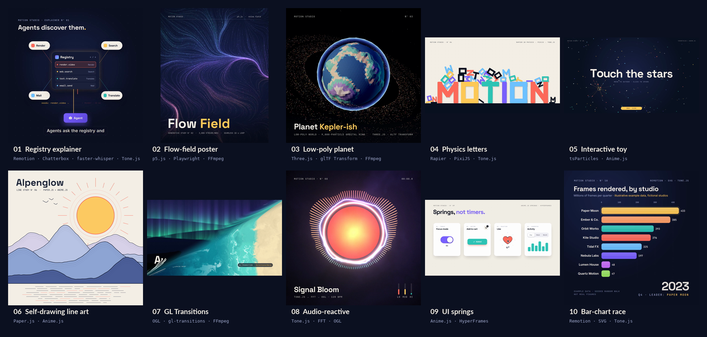

# Motion Studio examples

Ten short pieces made by the Motion Studio bot, each combining several tools from the [stack](../README.md#the-stack). Every frame was rendered headless on a CPU-only Linux box (no GPU; WebGL runs on SwiftShader). Every folder has the source and a `render.sh` that rebuilds it.



| Piece | What it is | Tools | Rebuild |
| --- | --- | --- | --- |
| [01 Registry explainer](media/01-registry-explainer.mp4) | 12 s square kinetic-typography explainer, "What a capability registry does", with a synthetic voiceover, word-timed captions and a music bed. | Remotion, Chatterbox TTS, faster-whisper, Tone.js, FFmpeg | `./01-registry-explainer/render.sh` · [notes](01-registry-explainer/) |
| [02 Flow-field poster](media/02-flow-field-poster.mp4) | 10 s seamless loop of a p5.js noise flow field (1080x1350), plus a high-res poster still from the same sketch. | p5.js, Playwright (deterministic frame stepping), FFmpeg | `./02-flow-field-poster/render.sh` · [notes](02-flow-field-poster/) |
| [03 Low-poly planet](media/03-lowpoly-planet.mp4) | 10 s glowing low-poly planet with a Keplerian particle ring. The planet GLB is generated and optimized with glTF Transform, then rendered in Three.js with bloom. | Three.js, glTF Transform, Playwright, FFmpeg | `./03-lowpoly-planet/render.sh` · [notes](03-lowpoly-planet/) |
| [04 Physics letters](media/04-physics-letters.mp4) | 10 s 1920x1080 piece: letters drop, collide and settle. The Rapier 2D simulation runs in Node first, PixiJS draws each frame from it, and Tone.js synthesizes impact sounds at the contact times. | Rapier, PixiJS, Tone.js, Playwright, FFmpeg | `./04-physics-letters/render.sh` · [notes](04-physics-letters/) |
| [05 Interactive toy ("Constellation")](media/05-interactive-toy.mp4) | Single-file interactive HTML toy: a reactive tsParticles field with Anime.js intro, magnetic title letters, spring cursor ring and click ripples. The MP4 is a capture driven by a scripted cursor on a fake clock. | tsParticles, Anime.js, esbuild, Playwright, FFmpeg | `./05-interactive-toy/render.sh` · [notes](05-interactive-toy/) |
| [06 Paper mountains](media/06-paper-mountains.mp4) | 11 s self-drawing line-art landscape. Paper.js builds the vector scene, a seeked Anime.js timeline drives every stroke's draw-on, and the final frame is exported as a standalone SVG (fonts embedded) and PNG. | Paper.js, Anime.js, Playwright, FFmpeg | `./06-paper-mountains/render.sh` · [notes](06-paper-mountains/) |
| [07 GL transitions](media/07-gl-transitions.mp4) | 12 s reel of four OGL-rendered stills joined by three GL Transitions shaders (CrossWarp, DirectionalWarp, Swirl). | OGL, gl-transitions, Playwright, FFmpeg | `./07-gl-transitions/render.sh` · [notes](07-gl-transitions/) |
| [08 Audio-reactive visualizer](media/08-audio-reactive.mp4) | 12 s square visualizer: a Tone.js track is rendered offline, analysed into a per-frame FFT, and an OGL fragment shader reacts to it frame by frame. | Tone.js, FFT analysis (Node), OGL, Playwright, FFmpeg | `./08-audio-reactive/render.sh` · [notes](08-audio-reactive/) |
| [09 UI springs](media/09-ui-springs.mp4) | 8 s 1920x1080 UI micro-interaction study, "Springs, not timers": a toggle, an add-to-cart button, a like heart and a segmented chart, each driven by Anime.js springs with a scripted cursor, composed and rendered with HyperFrames. | Anime.js, HyperFrames, FFmpeg | `./09-ui-springs/render.sh` · [notes](09-ui-springs/) |
| [10 Data race](media/10-data-race.mp4) | 12 s square bar-chart race in Remotion + SVG with a Tone.js music bed. All data is fictional: it comes from a seeded random walk, and the label "illustrative example data, fictional studios" stays on screen for the whole piece. | Remotion, SVG, Tone.js, FFmpeg | `./10-data-race/render.sh` · [notes](10-data-race/) |

Extra media: [02 poster PNG (1440x1800 web copy)](media/02-flow-field-poster-1440x1800.png) · [05 interactive HTML](media/05-interactive-toy.html) (download and open in a browser) · [06 final SVG](media/06-paper-mountains-final.svg) · [06 final PNG](media/06-paper-mountains-final.png).

All MP4s are H.264 yuv420p with `+faststart`. The data in 10 is fictional and labelled as such on screen.

## Setup

Run these once, from this `examples/` folder. You need Node.js 20+, FFmpeg on `PATH`, and, for 01 only, Python 3.11.

```bash
npm ci                                  # pinned JS deps from package.json / package-lock.json
npx playwright-core install chromium    # headless Chromium for capture (or set CHROME_PATH to an existing Chrome/Chromium)
npx hyperframes browser ensure          # browser for 09 (HyperFrames)
```

The Remotion pieces (01 and 10) download their own headless shell on first run. To reuse an existing one, set `CHROME_HEADLESS_SHELL` to its path.

Python environments for 01 (voice and captions). Keep them anywhere and point the env vars at their interpreters:

```bash
python3.11 -m venv .venvs/chatterbox && .venvs/chatterbox/bin/pip install -r requirements-chatterbox.txt
python3.11 -m venv .venvs/whisper    && .venvs/whisper/bin/pip install -r requirements-whisper.txt
export CHATTERBOX_PY=$PWD/.venvs/chatterbox/bin/python WHISPER_PY=$PWD/.venvs/whisper/bin/python
```

Model weights are downloaded into the usual Hugging Face cache on first use. They are not part of this repo.

## Rendering

```bash
./06-paper-mountains/render.sh   # any piece; outputs land in its folder (gitignored)
npm run contact-sheet            # rebuilds media/contact-sheet.png from media/*.mp4
```

Optional environment variables: `CHROME_PATH` (browser used for capture), `CHROME_HEADLESS_SHELL` (Remotion), `FRAMES_DIR` (scratch dir for frames; defaults to the OS temp dir).

## Layout

| Path | Contents |
| --- | --- |
| `NN-slug/` | Source, `render.sh` and README for one piece |
| `lib/` | Shared helpers: deterministic capture (`capture.mjs`, parallel `pcapture.mjs`), stills, Tone.js offline render, esbuild wrapper, palette, fonts, contact sheet |
| `media/` | Finished renders shown in this gallery |

## How the capture works

Each page exposes `window.renderFrame(t)`. The capture helpers load it in headless Chromium, step `t` frame by frame, screenshot the canvas and pipe the frames to FFmpeg. If a piece's frames are pure functions of `t`, the frames are split across parallel workers. Interactive pieces such as 05 run on Playwright's fake clock with a scripted mouse. Audio is rendered offline with Tone.js (`lib/tone-render.mjs`) and muxed in by FFmpeg.

Generated files (bundles, simulation and FFT data, GLB, WAVs, frames, per-folder renders) are rebuilt by `render.sh` and are not committed.
